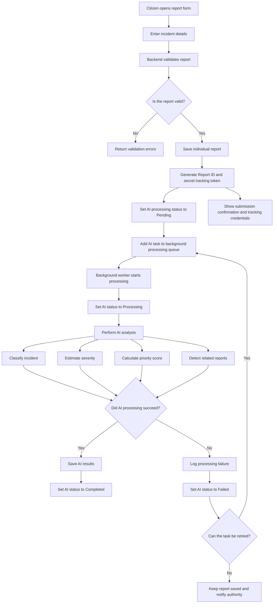
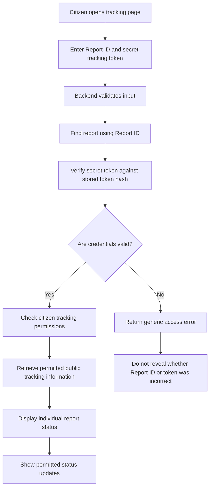
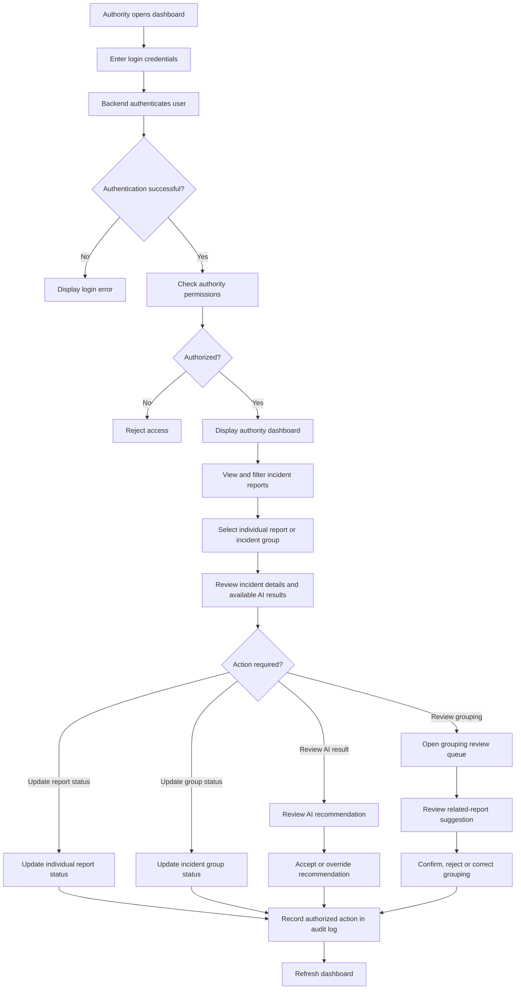
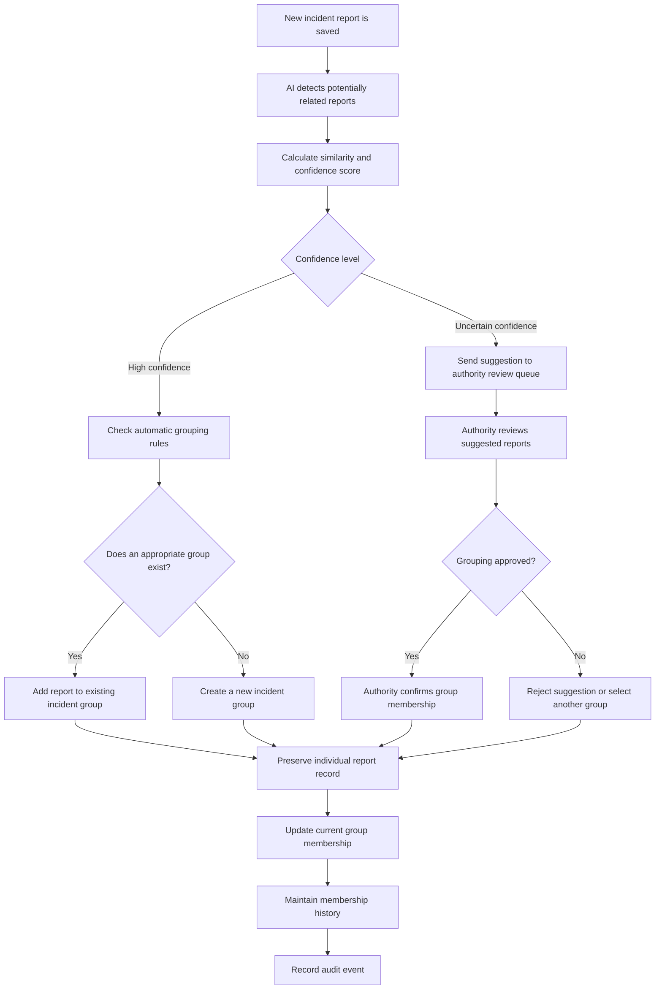
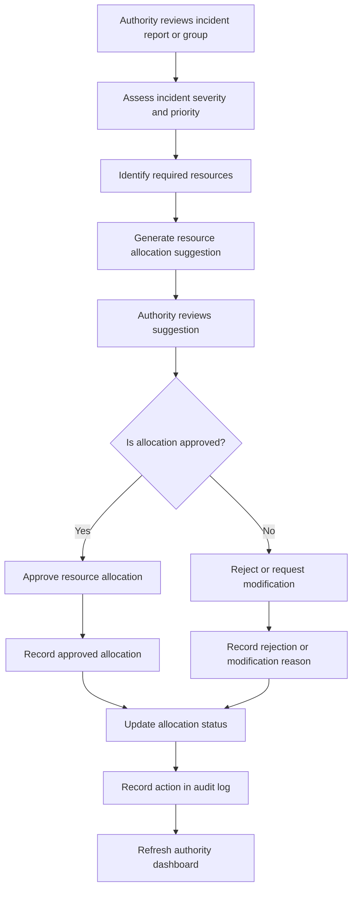
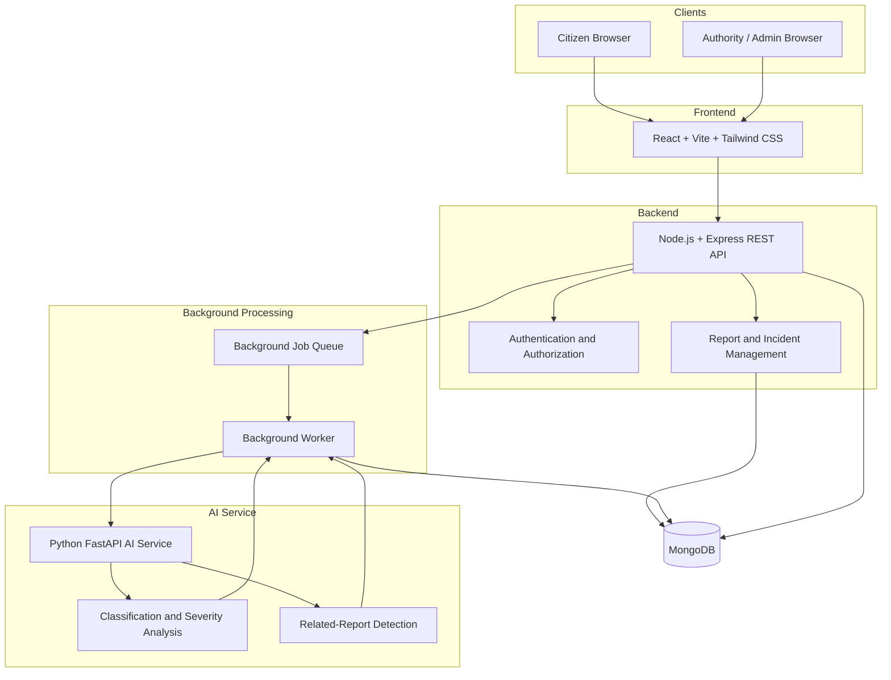

# 10 --- Workflows and Diagrams

## 1. Public Report Submission and Hybrid AI Processing

**Workflow notes:**

- A valid report must be saved before AI processing begins.
- The citizen receives submission confirmation without waiting for AI analysis.
- AI processing runs in the background.
- AI processing status is maintained separately from individual report and incident-group statuses.
- Failed AI tasks must not cause submitted reports to be lost.
- Failed tasks may be retried according to predefined retry rules.
- AI-generated results remain advisory and require human review before becoming confirmed operational decisions.

## 2. Secure Report Tracking

**Workflow notes:**

- Citizens must provide both the Report ID and its corresponding secret tracking token.
- The backend must verify the token securely without storing the raw token.
- Report ID alone must never grant access to tracking information.
- Invalid credentials must produce a generic error that does not reveal whether a report exists.
- Citizens may view only information explicitly approved for public tracking.
- Public tracking must not expose internal authority notes, private incident-group information, AI processing details or another citizen's report.
- Tracking access must be protected against repeated unauthorized attempts.

## 3. Authority Review and Management

**Workflow notes:**

- Only authenticated and authorized authorities may access the authority dashboard and its protected operations.
- Authorities can view, search and filter incident reports.
- AI-generated classification, severity and priority results are recommendations for human review.
- Authorities can update individual report statuses and incident-group statuses independently.
- Authorities can review uncertain related-report suggestions and correct group membership according to their permissions.
- Important status changes, AI review actions and grouping modifications must be recorded in the audit log.
- Every operation must be authorized by the backend, not merely controlled by frontend visibility.

## 4. Related-Report Detection and Incident Grouping

**Grouping rules:**

- High-confidence matches may be grouped automatically according to predefined thresholds and grouping rules.
- Uncertain matches must be sent to the authority review queue.
- Authorities can confirm suggested groupings and add, remove or move reports between groups.
- Administrators can handle exceptional group membership corrections.
- Every membership change must preserve the previous group ID, new group ID, affected report, actor, timestamp and reason.
- Individual reports must retain their unique Report IDs and original report records.
- Grouping must never delete or overwrite individual reports.
- Individual report statuses and incident-group statuses must remain independent.
- All membership changes must be recorded in the audit history.

## 5. Resource Allocation Workflow

**Workflow notes:**

- The system may generate resource allocation suggestions based on incident information, severity and priority.
- Resource allocation suggestions must be reviewed by an authorized authority.
- Authorities are responsible for approving or rejecting allocation suggestions.
- Rejection and modification reasons should be recorded.
- Approved allocations and important decisions must be recorded in the audit log.
- AI-generated recommendations must not independently authorize or execute operational resource allocation.

## 6. Conceptual System Architecture

**Architecture notes:**

- **Frontend:** Provides separate interfaces for citizens and authority/administrative users.
- **Backend API:** Handles report validation, authentication, authorization, business logic and communication between system components.
- **Authentication and Authorization:** Protects authority and administrator operations according to assigned roles and permissions.
- **Report and Incident Management:** Handles individual reports, incident groups, report statuses and group statuses.
- **Background Job Queue:** Holds AI processing tasks so that report submission does not have to wait for AI analysis.
- **Background Worker:** Executes queued tasks and communicates with the AI service.
- **AI Service:** Performs incident classification, severity estimation, priority scoring and related-report detection.
- **Database:** Stores incident reports, incident groups, user information, AI results, processing states and audit records.
- **Human Review:** AI-generated predictions and resource allocation suggestions remain advisory and are subject to authorized human review.

The background queue and worker represent conceptual components. The specific queue technology and deployment arrangement will be decided during detailed technical design.